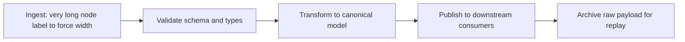

# Sample Document

Document: Pipeline smoke test
Version: 1.0.0
Owner: You
Language: en

---

# 1. Purpose

A short file to confirm the toolchain works end to end. It exercises a wide diagram, a table, and a code block. The `Language:` line above and the diagram's `accTitle` and `accDescr` give screen readers what they need, so this file exports without accessibility warnings.

Label
Value on its own line, to show soft line breaks are preserved.

# 2. A diagram that needs its own page



# 3. A table

| Item | Notes |
|---|---|
| Diagrams | Rendered as vector SVG |
| Images | Embedded as base64 |

```python
print("hello")
```
