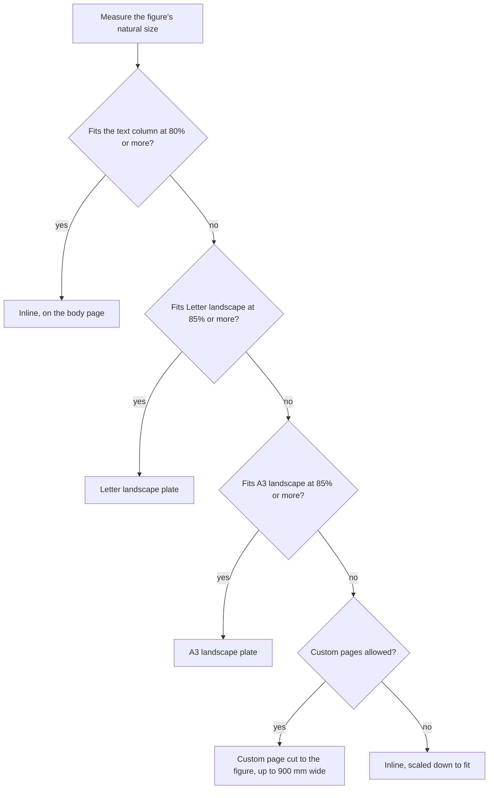

# How pages are chosen

Online is the default output mode. For every figure, Plate|Fold picks **the smallest page that shows it at a readable size**.

A figure is a Mermaid diagram or an image. Before anything prints, Plate|Fold measures the figure's natural size and walks up a ladder of pages. It stops at the first rung where the figure keeps enough of its size. Body text stays on its own pages.

{ .pf-figure }
{ .pf-figure }

The pages in that drawing are to scale with one another. The custom page is one example; its real size comes from the figure.

For custom sheet dimensions, exact edge margins and finer control over placement, see [Advanced layout](../reference/configuration.md#advanced-layout).

## Printing and assembling diagrams

Choose **Print** to put every page on the selected sheet size. Diagrams stay whole and scale down when they need to fit. Letter, Legal, Tabloid, A5 through A0, and ANSI C through E are available in portrait or landscape. Choose a larger sheet for a plotter when shrinking would make a diagram hard to read.

Choose **Tiled print** to keep large diagrams at their rendered size across several sheets. The PDF gives the number of columns and rows before each tiled figure. Sheets follow left to right, then top to bottom. Neighbouring sheets repeat a 10 mm strip of the diagram where they meet, and every sheet carries trim marks, overlap marks and a label naming the figure and its row and column. Small figures stay inline at full size; Mermaid diagrams and SVG files remain vectors. Raster images retain their available detail, subject to the selected image DPI.

Print tiled PDFs at **actual size (100%)**. A printer's “fit to page” option changes the scale and the joins. A diagram that would require more than 400 sheets is rejected; choose larger paper for that export. [Printing and assembling tiles](tiles.md) covers the marks, the overlap setting and how to put the sheets together.

| Page margins | What you get |
| --- | --- |
| Full margin | Blank space on all four edges. The default body margins are 15 mm, with 18 mm at the bottom. For tiled print this is the best choice: every edge has room for marks. |
| No margin | Content can reach every edge. Use a borderless printer. |
| Bottom and right only | Blank bottom and right strips for taping, with content reaching the top and left. Those edges need borderless printing or trimming. |

Tiled output omits running headers and footers so they cannot cover the diagram, its marks or its labels. Other modes omit them when Full margin is not selected or exact margins override it. The figure's caption and the assembly instructions come before the first sheet, and each sheet repeats the figure number and name in its label.

**Automatic** keeps Letter as the Online body size. For Print and Tiled print, it suggests Letter or A4 from the device locale's region, using [Unicode CLDR's paper preferences](https://github.com/unicode-org/cldr/blob/main/common/supplemental/supplementalData.xml). An unknown or regionless locale falls back to A4. There is no network location lookup. The HTTP API uses the client's `locale_hint`, never the server's locale. An explicit paper choice always wins.

```console
platefold diagram.md -o pdfs --output-mode print --preset a1 --orientation landscape
platefold diagram.md -o pdfs --output-mode tiled --preset letter --margins bottom-right
platefold notes.md -o pdfs --output-mode print --locale de-DE
```

The same choices can travel with a document in `platefold.yml`:

```yaml
page:
  output_mode: tiled
  preset: letter
  orientation: portrait
  margin_mode: full

layout:
  tile_overlap: 10
```

## The Online ladder



**Scale** here means the size a figure is printed at compared with its natural size. `1.0` is full size. Plate|Fold never enlarges a figure, so the scale on every rung tops out at `1.0`.

### Rung 1: the text column

The figure stays inline if it can print at 80% of its natural size or more. The test is against the body page's content area, the page minus its margins. On the default Letter page that area is 185.9 mm wide. The figure also has to fit within 92% of the column's height.

### Rungs 2 and 3: plates

A **plate** is a page given over to one figure, like the full-page illustrations in a printed book. The plates are tried in order, and each has to hold the figure at 85% or more:

| Plate | Page size | Margin |
| --- | --- | --- |
| Letter landscape | 279.4 × 215.9 mm | 12 mm |
| A3 landscape | 420 × 297 mm | 14 mm |

A plate also reserves 52 CSS pixels of height for the caption. Those two plates are the same under the `letter` and `a4` presets.

### Rung 4: a custom page

If neither plate is big enough, Plate|Fold cuts a page to the figure. It adds a 12 mm margin on each side and room for the caption, then rounds the dimensions up to the next tenth of a millimetre, since rounding to the nearest value could shave a sliver off a figure that exactly fills its page. A custom page is at least 90 mm tall, so a long, shallow flowchart still gets a page of a sensible height. Custom pages are capped at 900 mm wide, and a figure wider than that is scaled down until it fits the cap. While plates and custom pages are on, this and the inline rung, which accepts 80% or more, are the only places a figure can print below 85%.

## When nothing larger is allowed

The `uniform-letter` preset turns plates and custom pages off. Every page is Letter portrait, and a wide figure is scaled down into the text column at whatever size fits. Setting `max_custom_width` to `0` keeps the plates but turns off custom pages, so a figure too big for A3 falls back to the text column the same way.

Use `uniform-letter` when the PDF is going to a printer that only takes one paper size, or into a system that expects uniform pages. Expect small text in wide diagrams.

## Tuning the thresholds

All four numbers are settings. In `platefold.yml`:

```yaml
layout:
  inline_fit: 0.8
  plate_fit: 0.85
  max_custom_width: 900
  caption_px: 52
```

Lower `inline_fit` keeps more figures in the text flow at smaller sizes. Raise `plate_fit` and figures move up the ladder sooner. Each setting's allowed range is in the [configuration reference](../reference/configuration.md#layout).

Test changes on real documents. These thresholds decide page counts for a whole corpus, and a small change can move many figures at once.

## How figures are measured

**Mermaid diagrams** are rendered to SVG in the browser first, then measured with the SVG's tight bounding box. Mermaid's declared `viewBox` often includes empty space, and sizing from it would waste page area. The label font size and wrapping width, `mermaid_font_px` and `mermaid_wrap_px`, change a diagram's natural size, so they change which rung it lands on.

**Raster images** use their pixel dimensions as their natural size, with one pixel counted as one CSS pixel. A photo's EXIF orientation is applied first, so a portrait phone photo is measured, placed and printed upright; WebP images are the exception, because the browser ignores their EXIF orientation. With default settings, a 2400 × 900 pixel screenshot measures about 635 mm wide and gets a custom page of about 660 × 277 mm. Resize large screenshots before exporting if you want them inline. `image_dpi` only controls how much resolution is kept after placement; it doesn't change the placement.

**SVG image files** referenced with `` keep the existing column-width behavior in Online mode. Print and Tiled print measure absolute root dimensions or the `viewBox`; files without usable dimensions need a width and height or a valid `viewBox` before printing.

**Image frames** are 1 px (0.75 pt) hairlines in the theme's rule colour around raster and SVG image files. The frame is drawn outside the picture and the ladder leaves room for it, so the picture prints at exactly its scale and the whole frame stays on the page. Mermaid diagrams and tiled sheets have no frame. Chromium prints an image's box on whole CSS pixels, so an image's placed width is rounded down to a whole pixel, at most 1/96 inch smaller than the ladder's exact fit.

## What moves when you change something

Placement depends on measurement, so anything that changes a figure's measured size can move it to another page:

- a different font set, or a font missing on this machine
- `mermaid_font_px` or `mermaid_wrap_px`
- the body page size or margins
- a browser version that lays out text differently

Plate|Fold caches rendered diagrams. The cache key includes every setting that changes a diagram's geometry or colours, so changing one re-renders only the affected diagrams. A diagram that fails to render isn't cached, and the next export tries again.

## What the page around a plate looks like

A plate is its own page, so the text before it stays on the body page and the plate follows. When a heading and a short lead-in come right before a wide diagram, that body page can be mostly empty, as on pages 3 and 5 of the [sample PDF](../reference/sample.md). There's no setting to change this yet.

Plates carry the figure's caption. There's no separate plate numbering yet; plates and inline figures share one figure count.
