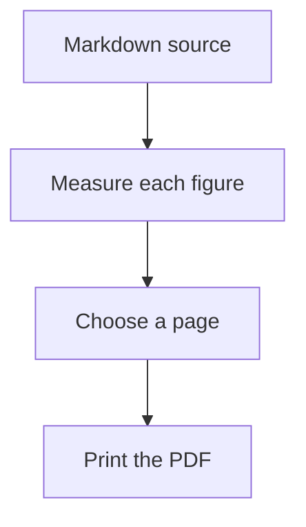
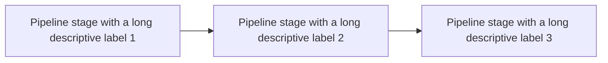
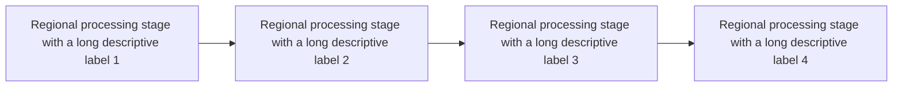

# Plate|Fold sample document

Document: Placement ladder tour
Version: sample
Owner: Plate|Fold documentation
Language: en

This file is the input for the sample PDF on the documentation site. It holds four diagrams of increasing width, and each one is wide enough to need the next rung of the page ladder. Nothing else about the document changes, so the page sizes in the PDF come from the diagrams alone.

# A diagram that fits the text column

A short flow stays inline, on the body page, beside the prose that explains it.



The rest of this section is ordinary body text. Soft line breaks are kept, so
this sentence and the one before it
stay on separate lines, the way they were typed.

# A diagram that needs a landscape plate

Three stages with long labels are too wide for the text column at 80%, so the diagram moves to a Letter landscape plate on the next page.



# A diagram that needs an A3 plate

Four stages no longer fit Letter landscape at 85%, so the next rung is an A3 landscape plate.



# A diagram that needs its own page size

Seven stages are wider than A3 can hold at 85%. The last rung cuts a page to the diagram's own proportions.

```mermaid
flowchart LR
    accTitle: Seven distribution steps
    accDescr: Distribution steps 1 through 7 proceed in numerical order.
    c0["Distribution step with a deliberately long descriptive label 1"] --> c1["Distribution step with a deliberately long descriptive label 2"] --> c2["Distribution step with a deliberately long descriptive label 3"] --> c3["Distribution step with a deliberately long descriptive label 4"] --> c4["Distribution step with a deliberately long descriptive label 5"] --> c5["Distribution step with a deliberately long descriptive label 6"] --> c6["Distribution step with a deliberately long descriptive label 7"]
```



# A table and some code

| Rung | Page | Accepted when |
| --- | --- | --- |
| Inline | Body page | The figure keeps at least 80% of its size |
| Plate | Letter landscape, then A3 landscape | At least 85% |
| Custom | Cut to the figure, up to 900 mm wide | Nothing smaller holds it at 85% |

```console
platefold ladder-tour.md -o pdfs --theme bristol --font sora
```
