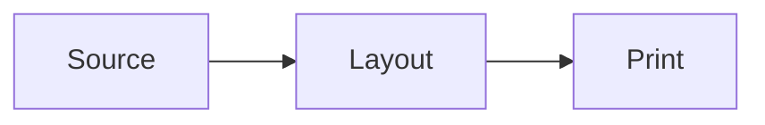
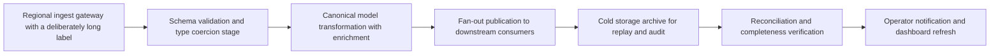

# Cross-Platform Layout Fixture

Document: Pagination agreement across operating systems
Version: 1.0.0
Owner: Test Suite

---

# 1. Running text

A print layout is only reproducible when every machine that exports it measures
the same glyphs. This document uses nothing but the bundled typefaces, so the
browser on each operating system shapes the same font files. Each paragraph is
long enough to wrap several times, and every wrap is a place where a small
difference in advance widths would move a word to the next line. Enough of those
moves in a row would push a heading onto another page, which is exactly what the
test that reads this document is watching for.

The paragraphs below are deliberately plain. They avoid ligature-heavy words,
characters outside the Latin range and anything that would fall back to a system
face. **Bold runs use the bundled bold weight**, and `inline code uses the
bundled monospace face`, so the three faces that ship with the package all
appear on the first page.

Line breaking follows the same rules everywhere: a break is allowed after a
space, hyphenation is off, and justification is not used. What can still differ
between platforms is how each operating system's font stack rounds the width of a
glyph once the page is scaled for print. A document that paginates identically on
Linux, Windows and macOS shows that the rounding stays below the threshold where
it would change a line.

# 2. Lists and a table

1. The first item is short.
2. The second item is long enough to wrap onto a second line within the text
   column, which exercises the hanging indent of an ordered list.
3. The third item closes the list.

| Column | Purpose | Notes |
|---|---|---|
| Alpha | The first row of the table | Short |
| Bravo | A row whose note wraps within its cell because it is longer than the others | Wraps |
| Charlie | The last row | Short |

> A block quote sits in its own tinted box, with its own padding, and wraps at a
> narrower measure than the running text around it.

# 3. Code

```python
def paginate(blocks, page_height):
    pages, current, used = [], [], 0
    for block in blocks:
        if used + block.height > page_height and current:
            pages.append(current)
            current, used = [], 0
        current.append(block)
        used += block.height
    return pages + [current] if current else pages
```

# 4. A diagram that fits the column



# 5. A diagram that needs its own page

The diagram below is too wide for the text column, so it is promoted onto a page
sized to fit it. Its page size depends on the measured width of every label.



# 6. Closing text

After the wide page, the document returns to the body size. This section adds
enough text to run past a page boundary on its own, so the final page count
depends on every line above it as well as the lines here.

A careful reader will notice that the paragraphs in this document repeat the
same few ideas. That is intentional: the content is there to occupy space in a
predictable way, and a paragraph that says something new would be no better at
that job than one that restates the purpose of the test.

Each operating system ships a different font rasteriser. Linux builds of the
browser use FreeType, Windows builds use DirectWrite and macOS builds use Core
Text. All three load the same embedded font files here, and the browser's own
text shaper decides where each glyph goes. The rasteriser only decides how the
glyph is drawn, which is why the page count can agree even though the pixels do
not.

The last paragraph is the one most likely to move. If the lines above it are a
fraction of a point taller on one platform, this paragraph is the first to spill
onto a new page, and the page count assertion fails with both counts in its
message.

# 7. Appendix

## 7.1 Repeated measure

The same sentence, repeated, gives a long run of identical lines. The same
sentence, repeated, gives a long run of identical lines. The same sentence,
repeated, gives a long run of identical lines. The same sentence, repeated, gives
a long run of identical lines. The same sentence, repeated, gives a long run of
identical lines. The same sentence, repeated, gives a long run of identical lines.

## 7.2 Numbers

Figures such as 1,234.56 and 7,890.12, dates such as 2026-01-31, and ranges such
as 10 to 20 are measured with the same bundled face as the words around them.
