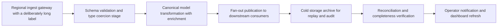
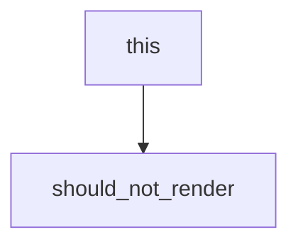

# Wide Diagram Fixture

Document: Placement ladder exercise
Version: 2.1.0
Owner: Test Suite

---

# 1. Narrow diagram

This one is small enough to sit in the running text column.


# 2. Wide diagram

Wide enough that scaling it into the text column would make it unreadable, so
it must be promoted onto a page of its own.



# 3. Fenced block that merely mentions mermaid

The block below documents the syntax. It must not be rendered as a diagram.

````markdown

````

Text after the nested fence.
